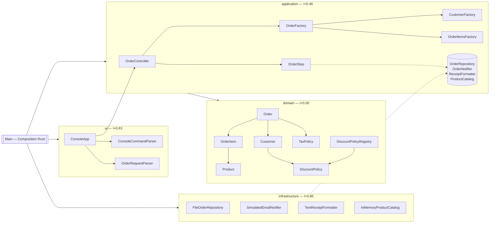

# Лабораторна робота №8
## Проєктування та рефакторинг взаємодії об'єктів за методологією GRASP

**Варіант:** 1 — Інтернет-магазин електроніки та побутової техніки (обробка замовлення)
**Мова:** Java 17 · **Тести:** JUnit 5 (20 тестів) · **Виконали:** Студент А ____________ / Студент Б ____________

---

## 1. Завдання 1 — аудит legacy-коду та Design Rationale

Повний аудит і таблиця порушень — [ADR-001](adr/ADR-001-audit-legacy-code.md). Коротко:

| Показник legacy-коду | Значення |
|----------------------|:--------:|
| публічні змінні поля (Anemic Model) | 19 |
| обов'язків в одному методі (`processConsoleOrder`) | 9 |
| звернень до полів чужих класів (Feature Envy) | 47 |
| ланцюжків, що порушують Закон Деметри | 6 |
| гілок `if / else if` за рядковим типом клієнта | 3 |
| магічних чисел у бізнес-коді | 9 |

Документи обґрунтування: ADR-001…ADR-005 та QOC-001…QOC-004 у каталозі [`docs/adr/`](adr/).

---

## 2. Структура рефакторингу



Дерево пакетів:

```
src/main/java/ua/lab8
├── Main.java                         Composition Root
├── domain/                           Order, OrderItem, Customer, Product, OrderStatus
│   ├── discount/                     DiscountPolicy, PercentageDiscount, Vip/Regular/NewCustomerDiscount, DiscountPolicyRegistry
│   └── tax/                          TaxPolicy, VatTaxPolicy
├── application/                      OrderController, CatalogController
│   ├── dto/                          PlaceOrderCommand, OrderLineRequest, ProductView
│   ├── factory/                      OrderFactory, CustomerFactory, OrderItemsFactory
│   ├── port/                         OrderRepository, OrderNotifier, ReceiptFormatter, ProductCatalog
│   └── step/                         OrderStep, ReceiptStep, PersistOrderStep, NotifyCustomerStep
├── infrastructure/                   FileOrderRepository, SimulatedEmailNotifier, TextReceiptFormatter, InMemoryProductCatalog
└── ui/                               ConsoleApp, ConsoleCommandParser, OrderRequestParser, MenuChoice
```

### 2.1. Завдання 2 — Information Expert + Creator

| Було (legacy) | Стало |
|---------------|-------|
| `subtotal += item.product.price * item.quantity` у процесорі | `OrderItem.subtotal()` → `Product.priceFor(qty)`; `Order.subtotal()` |
| `order.discountAmount = order.totalAmount * discountRate` | `Order.discountAmount()` → `Customer.discountOn(...)` |
| `order.taxAmount = (…) * 0.20` | `Order.taxAmount()` → `TaxPolicy.taxOn(...)` |
| `order.status = "Processed"` (рядок, будь-де) | `Order.process()` + `OrderStatus`, перехід лише раз і лише з валідною сумою |
| `new Customer(); customer.id = 1; …` | `Customer.register(...)` з валідацією |
| `order.items.add(item)` (відкрита колекція) | `Order.place(..., List<OrderItem>)` + `List.copyOf` |

Обґрунтування — [ADR-002](adr/ADR-002-information-expert-and-creator.md), [QOC-001](adr/QOC-001-who-calculates-discount.md), [QOC-002](adr/QOC-002-who-creates-order-and-items.md).

### 2.2. Завдання 3 — Controller + Indirection + Pure Fabrication

* `ConsoleApp` — тонкий CLI: меню, `Scanner`, `PrintStream`; **0 рядків бізнес-логіки**.
* `OrderController` — Use-Case Controller: фабрика → `order.process()` → кроки; **0 звернень до консолі**
  (перевірено: `grep -rE "System\.(out|in)|Scanner|println" domain application` — порожньо).
* Indirection: порти `OrderRepository`, `OrderNotifier`, `ReceiptFormatter`, `ProductCatalog` + `OrderStep`.
* Pure Fabrication: парсери, фабрики, реєстр знижок, адаптери інфраструктури.

Обґрунтування — [ADR-003](adr/ADR-003-controller-indirection-pure-fabrication.md), [QOC-004](adr/QOC-004-where-to-put-receipt-persist-notify.md).

### 2.3. Завдання 4 — Polymorphism + Protected Variations

Каскад `if-else` за типом клієнта замінено ієрархією `DiscountPolicy` та `DiscountPolicyRegistry`;
ставка ПДВ — за `TaxPolicy`; формат рахунку, сховище й сповіщення — за інтерфейсами.
Тест `newCustomerTypeCanBeAddedWithoutChangingExistingCode` доводить, що тип «Gold» додається без
змін існуючого коду. Обґрунтування — [ADR-004](adr/ADR-004-polymorphism-protected-variations.md), [QOC-003](adr/QOC-003-replace-if-else-by-customer-type.md).

### 2.4. Закон Деметри

| Порушення (legacy) | Виправлення |
|--------------------|-------------|
| `order.customer.name` / `.email` / `.type` | `order.customerName()`, `order.customerEmail()`, `order.customerType()` |
| `item.product.price` | `item.subtotal()` → `product.priceFor(qty)` |
| `item.product.name` (для рахунку) | `item.productName()` |

Ланцюжків Деметри в новому коді: **0**.

---

## 3. Завдання 5 — метричний аналіз

Відтворення: `python3 tools/metrics.py src/main/java` та `python3 tools/metrics.py legacy`.

**Умови розрахунку.** CBO: лише типи проєкту (примітиви, `java.lang`, `java.util`, `java.math` не
рахуються). LCOM4: вершини — нетривіальні нестатичні методи (конструктори, статичні фабрики та
тривіальні геттери виключено); ребро — спільне поле або прямий виклик.

### 3.1. Low Coupling — CBO

| Клас | До | Після | Цільове ≤ 4 |
|------|:--:|:-----:|:-----------:|
| `LegacyOrderProcessor` → розділено на | **4** ¹ | — | |
| `OrderController` | — | **4** | ✓ |
| `CatalogController` | — | 3 | ✓ |
| `Order` | 2 | **4** | ✓ |
| `OrderItem` | 1 | 1 | ✓ |
| `Customer` | 0 | 1 | ✓ |
| `Product` | 0 | 0 | ✓ |
| `DiscountPolicyRegistry` | — | 4 | ✓ |
| `CustomerFactory` / `OrderItemsFactory` | — | 3 / 3 | ✓ |
| `ReceiptStep` / `PersistOrderStep` / `NotifyCustomerStep` | — | 3 / 3 / 3 | ✓ |
| `FileOrderRepository`, `SimulatedEmailNotifier`, `TextReceiptFormatter`, `InMemoryProductCatalog` | — | 2 | ✓ |
| `OrderFactory` (збирач агрегату) | — | 6 | ✗ ² |
| `ConsoleApp` (UI) | — | 6 | ✗ ² |
| `Main` (Composition Root) | — | 17 | ✗ ² |

¹ Чесне застереження: за правилом «лише типи проєкту» legacy-процесор уже має CBO = 4 (Customer,
Order, OrderItem, Product); якщо рахувати `java.util.Scanner` як інфраструктурний тип — 5.
Тобто сама метрика CBO **не показує різкого падіння**: вся «заплутаність» legacy була не в кількості
типів, а в тому, що **один метод** поєднував 9 обов'язків і 47 разів ліз у чужі поля. Це видно
в додаткових індикаторах (п. 3.4). Після рефакторингу жоден доменний клас і жоден контролер не
перевищує CBO = 4, причому `Order` зріс із 2 до 4 цілком свідомо: тепер він сам володіє логікою,
яку раніше мав процесор.

² Норматив методички стосується доменних сутностей і контролерів. Ці три класи —
свідомі точки концентрації зчеплення (збирання агрегату, UI, композиція); див.
[ADR-005](adr/ADR-005-metrics-and-coupling-budget.md).

### 3.2. High Cohesion — LCOM4

| Клас | До | Після | Зв'язність методів після рефакторингу |
|------|:--:|:-----:|---------------------------------------|
| `LegacyOrderProcessor` | 1 ³ | — | один метод з 9 обов'язками |
| `Customer`, `Product`, `OrderItem`, `Order` (legacy) | 0 ⁴ | — | методів немає — Anemic |
| `Customer` | | **1** | `discountOn`, `typeLabel` ← `discountPolicy` |
| `Product` | | **1** | `priceFor` ← `price` |
| `OrderItem` | | **1** | `subtotal`, `productName` ← `product` |
| `Order` | | **1** | `subtotal`→`discountAmount`→`taxAmount`→`finalAmount`→`process` (виклики); `customerName/Email/Type` ← `customer` (спільне з `discountAmount`) |
| `DiscountPolicyRegistry` | | **1** | `register`, `forType`, `supportedTypes` ← `byName` |
| `PercentageDiscount`, `Vip/Regular/NewCustomerDiscount` | | **1** | `discountOn` ← `rate`; `name()` — єдиний метод підкласу |
| `VatTaxPolicy` | | **1** | `taxOn` ← `rate` |
| `OrderController`, `CatalogController`, фабрики, кроки | | **1** | по одному публічному методу |
| `FileOrderRepository` | | **1** | `nextId`, `save`, `storageName` ← `file` |
| `ConsoleApp` | | **1** | `run` викликає `printMenu`, `placeOrder`, `showCatalog`, `ask` |

³ LCOM4 = 1 тривіально: у класі єдиний метод, метрика «сліпа» до його перевантаженості.
⁴ Немає вершин у графі — формально метрика не визначена (0 компонент); клас — лише контейнер даних.

Усі 25 класів із нетривіальними нестатичними методами мають **LCOM4 = 1** (вивід скрипта); `Main` має лише статичний метод, а решта — інтерфейси, records та enum без методів, для яких метрика не визначена.

### 3.3. Instability (I = Ce / (Ca + Ce)) на рівні шарів

| Шар | Ca | Ce | I |
|-----|:--:|:--:|:-:|
| `domain` | 18 | 0 | **0.00** |
| `application` | 7 | 6 | 0.46 |
| `infrastructure` | 1 | 6 | 0.86 |
| `ui` | 1 | 5 | 0.83 |
| `Main` (root) | 0 | 17 | 1.00 |

Принцип Stable Dependencies виконується: `ui (0.83) → application (0.46) → domain (0.00)`;
`infrastructure (0.86)` залежить від портів `application` і від `domain`. Домен не імпортує жодного
іншого шару (`grep "import ua.lab8.(application|infrastructure|ui)" domain` — порожньо); `application`
не імпортує `infrastructure`/`ui`. У legacy всі п'ять класів лежали в одному пакеті без шарів —
Instability не визначена.

### 3.4. Додаткові індикатори «до / після»

| Індикатор | До | Після |
|-----------|:--:|:-----:|
| публічні змінні поля | 19 | **0** |
| сеттери | відкриті поля | **0** |
| звернення до чужих полів | 47 | **0** |
| ланцюжки Деметри | 6 | **0** |
| гілки `if-else` за типом клієнта | 3 | **0** |
| обов'язків на метод/клас | 9 в одному методі | 1 на клас |
| консольний I/O у домені/контролері | так | **немає** |
| автоматичні тести | 0 | **20** |

### 3.5. Висновки

1. Бізнес-логіка перенесена у власників даних; домен став стабільним ядром (I = 0.00) без залежностей
   від інфраструктури.
2. CBO ≤ 4 досягнуто для всіх доменних сутностей і обох контролерів; максимум зчеплення
   сконцентровано в `OrderFactory`, `ConsoleApp` і `Main` — шарах, де воно й має жити.
3. LCOM4 = 1 для всіх 25 класів із поведінкою — кожен клас відповідає за один стан.
4. CBO окремо дає слабкий сигнал для цього legacy (там уже було 4) — переконливо покращення видно
   разом з LCOM-орієнтованими й структурними індикаторами (п. 3.4).

---

## 4. Відображення 9 патернів GRASP на код

| Патерн | Де застосовано |
|--------|----------------|
| Information Expert | `Product.priceFor`, `OrderItem.subtotal`, `Order.subtotal/discountAmount/taxAmount/finalAmount`, `Customer.discountOn` |
| Creator | `Customer.register`, `OrderItem.of`, `Order.place`, `OrderFactory`, `CustomerFactory`, `OrderItemsFactory` |
| Controller | `OrderController`, `CatalogController` |
| Low Coupling | CBO ≤ 4 для домену й контролерів; залежності лише від інтерфейсів |
| High Cohesion | LCOM4 = 1; по одній відповідальності на клас |
| Pure Fabrication | парсери, фабрики, `DiscountPolicyRegistry`, `TextReceiptFormatter`, `FileOrderRepository` |
| Indirection | порти + `OrderStep` між контролером і деталями |
| Polymorphism | `DiscountPolicy`-ієрархія, `OrderStep`-реалізації |
| Protected Variations | `DiscountPolicy`, `TaxPolicy`, `OrderRepository`, `OrderNotifier`, `ReceiptFormatter`, `ProductCatalog` |

---

## 5. Свідомі відмінності поведінки від legacy

| Legacy | Тепер | Чому |
|--------|-------|------|
| невідомий тип клієнта → знижка 0 без повідомлення | помилка зі списком типів | Fail Fast; прихований дефект |
| `double`, вивід `31600.0` | `BigDecimal`, `31600.00` | коректні гроші |
| «БД» і email — лише `println` | реальний запис у `orders.txt`; email симулюється (`SimulatedEmailNotifier`) | вимога «збереження у файл» |
| номер замовлення завжди 101 | 101, 102, … за кількістю рядків у файлі | унікальність між запусками |
| кошик і email зашиті | вводяться; `Enter` = демо-значення legacy | CLI як справжній клієнт |
| поле `totalSpent` | видалено | ніде не читалось (YAGNI) |

Перевірка еквівалентності: для демо-кошика й VIP legacy та новий код дають однакові суми
(31600 / 4740 / 5372 / 32232); це зафіксовано тестом `placesOrderAndRunsAllStepsInOrder`.

---

## 6. Як запустити

```bash
mvn test                              # 20 JUnit-тестів
mvn -q package && java -jar target/lab8-grasp-variant1-1.0.0.jar
python3 tools/metrics.py src/main/java   # CBO / LCOM4 / Instability
```

Без Maven: `javac -d out $(find src/main -name "*.java") && java -cp out ua.lab8.Main`.
